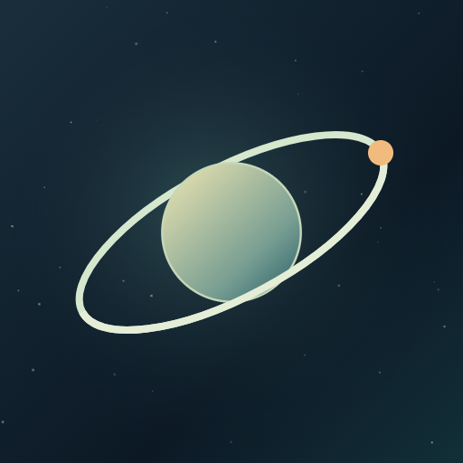
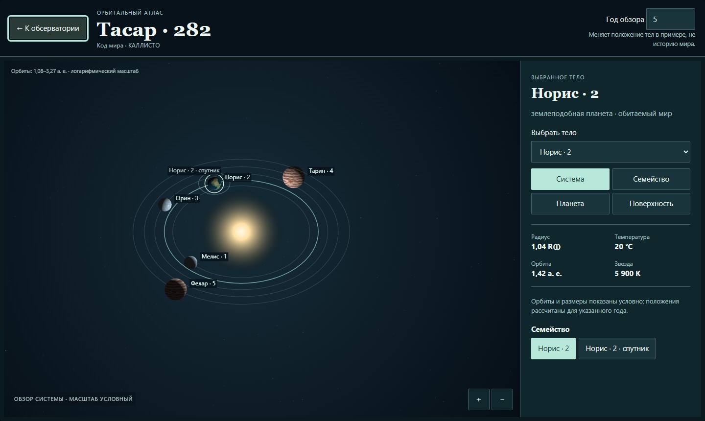
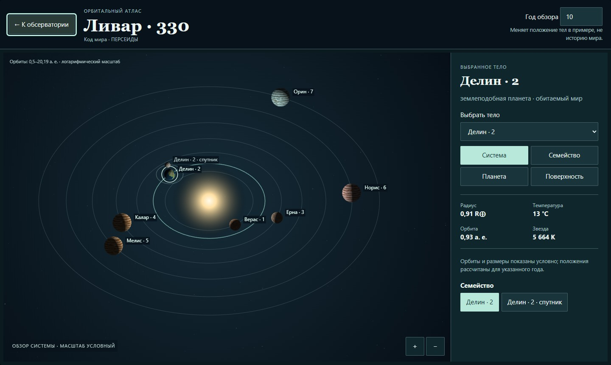
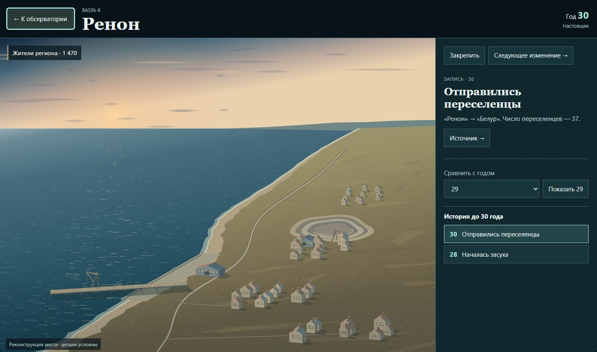

# Microgalaxy



**Браузерная обсерватория процедурных звёздных систем.** Найдите луну на орбите обитаемой планеты, рассмотрите её поверхность, а затем откройте хронику поселения на планете. Звезда, тела, регионы и общества принадлежат одному миру. Вы выбираете точку наблюдения и год.

[Открыть обсерваторию](https://microgalaxy.gubarevf.chatgpt.site/v1) · [Что появилось в 1.2](docs/RELEASE-1.2.md)

## Два орбитальных атласа

| Каллисто · 5-й год обзора | Персеиды · 10-й год обзора |
| --- | --- |
| [](docs/RELEASE-1.2.md) | [](docs/RELEASE-1.2.md) |
| У второй планеты Норис ледяная луна. [Открыть атлас](https://microgalaxy.gubarevf.chatgpt.site/v1?atlas=callisto) | У второй планеты Делин каменистая луна. [Открыть атлас](https://microgalaxy.gubarevf.chatgpt.site/v1?atlas=perseids) |

В «Семействе» найдите спутник рядом с его планетой, выберите его и откройте «Поверхность». Год обзора в примере меняет расположение тел и освещение. Примеры открываются отдельно от вашего архива. [Сравнить шесть видов и открыть любую из лун](docs/RELEASE-1.2.md)

## Начать наблюдение

Откройте `/v1` на запущенном сайте, создайте мир и выберите эпоху. На планете можно выбрать регион, открыть его паспорт и приблизиться к месту. «Куда посмотреть» предлагает примеры, а «Полевой атлас» помогает исследовать записи. Время можно поставить на паузу, ускорить и просмотреть доступные исторические состояния.

| Посещение | Что искать |
| --- | --- |
| [Илмир в 16-м году](https://microgalaxy.gubarevf.chatgpt.site/v1?place=meander) | Какие работы начинались как переправа и почему сменили назначение в 13-м году. |
| [Ренон в 30-м году](https://microgalaxy.gubarevf.chatgpt.site/v1?place=basin) | Куда отправились 37 жителей после засухи и какая запись связывает оба события. |

Оба примера запускают симуляцию в памяти. Для собственного мира выберите место на глобусе и нажмите «Приблизить место».

## Что можно исследовать

- **Систему и планету:** орбиты, спутники, рельеф, регионы, центры обществ и связи между ними.
- **Историю места:** записи, источники, доступные даты и переход к следующему изменению; закреплённое место удобно находить снова.
- **Экономику и общество:** ресурсы, перевозки, регионы, население, общественные навыки и причины доступных решений.
- **Реку и сооружения:** состояние бассейна, стадии реального проекта и связанные следы, когда они возникли в данном мире.
- **Знания и космос:** экспедиции, колонии, доступные сведения и задержку передачи сообщений.
- **Контрольные ветви:** отдельные продолжения мира позволяют сравнивать допустимые условия, не переписывая исходную историю.



## Что показывает изображение

Запись, регион, подтверждённый проект, его стадия и состояние модели — данные мира. Крупный план местности создаётся процедурно: отдельные здания, дороги и художественные детали не становятся фактами только потому, что видны на экране. Интерфейс помечает реконструкцию; источник и год помогают отличить запись от её образа. Модель не является научным прогнозом, а истории не создаются генеративным ИИ.

## Версии и сохранения

Браузерный интерфейс **1.2.0** открывает сохранения моделей **1.0.0 и 1.0.1** без миграции. Каждая история продолжается по правилам своей версии. Более ранние модели доступны по отдельным адресам. Локальный архив и облако хранят независимые ревизии. Доступ к облаку зависит от окружения и авторизации.

## Локальный запуск

Нужен Node.js **22.13 или новее**. В каталоге репозитория:

```bash
npm ci
npm run dev
```

Откройте локальный адрес, выведенный сервером, и перейдите на `/v1`. Сборка статических страниц симулятора выполняется скриптом запуска. Для проверок:

```bash
npm test
npm run typecheck
npm run build
```

Успешная локальная сборка не подтверждает опубликованный сайт или работу облачного архива. Доступ и привязки облачного хранилища зависят от развёртывания.

## Документация

- [Концепция и границы модели](docs/CONCEPT.md)
- [Возможности и работа с миром](docs/FUNCTIONS.md)
- [Орбитальный атлас 1.2 и галерея двух систем](docs/RELEASE-1.2.md)
- [Обновление интерфейса 1.1.0](docs/RELEASE-1.1.md)
- [Разработка и архитектура](docs/DEVELOPMENT.md)
- [История выпусков и архив прежнего README](docs/HISTORY.md)
- [Релиз 0.6](docs/RELEASE-0.6.md)
