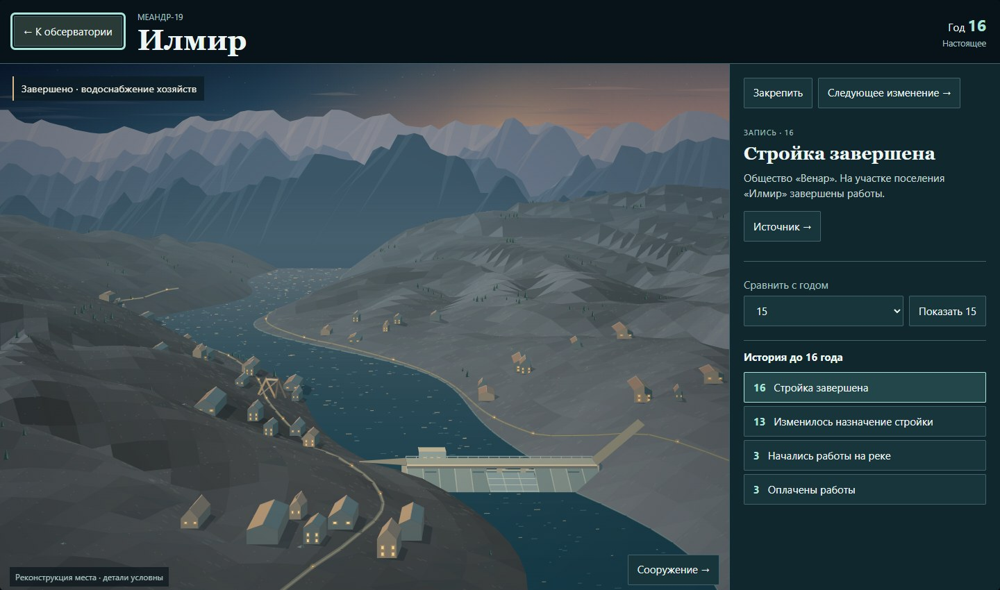
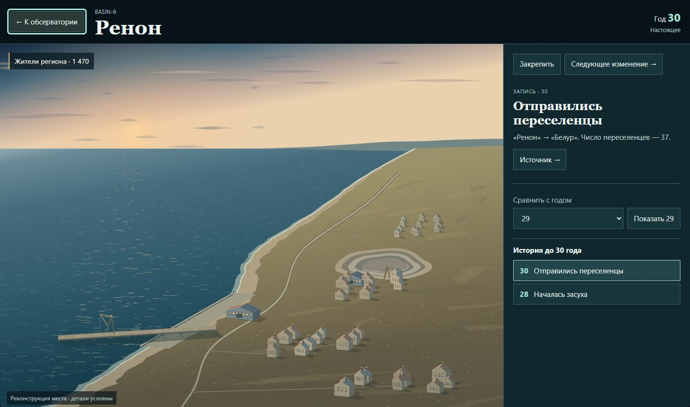
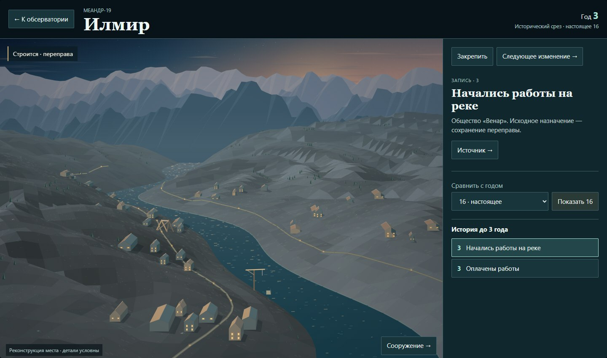
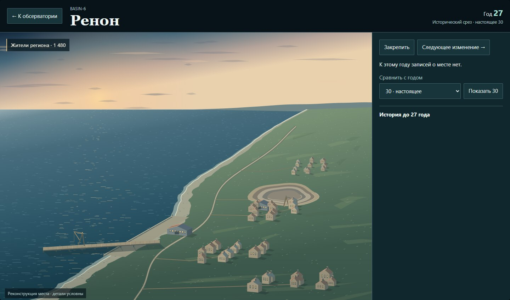

# Microgalaxy 1.1.0 — место на переднем плане

1.1.0 — браузерное обновление наблюдательского интерфейса. Его главный экран приближает выбранный регион: крупная процедурная сцена соединяется с годом, записью, источником и доступной историей. Версия интерфейса не меняет номер или правила сохранённой модели мира.

## Что меняется

- **Сцена места.** На широком экране пейзаж и карточка находятся рядом; на телефоне карточка следует за сценой. Название, мир и год показывают контекст.
- **Запись и источник.** Главное событие находится перед архивом. Выбор записи открывает её содержание; источник и подробности доступны отдельно. Длинная история раскрывается порциями.
- **Время места.** Доступные даты позволяют переходить между состояниями; год записи можно открыть, если он доступен для восстановления. Исторический год явно отличается от настоящего; тексты будущих записей скрываются.
- **Следующее изменение.** Из прошлого можно перейти к доступной последующей записи. В обычном живом мире поиск следующего изменения продолжает сам мир до 30 лет за один запрос. Остановка без найденной записи не означает, что изменений больше не будет.
- **Закрепление и возврат.** Интересующий регион можно закрепить и вернуться к планете; у самостоятельных примеров предусмотрен возврат в обсерваторию.
- **Сооружение.** Когда проект и его запись подтверждены, к записи можно перейти из сцены. Стадии связаны с данными проекта; условная графика помечена реконструкцией.

## Две самостоятельные истории

На работающем сайте `/v1?place=meander` открывает МЕАНДР-19 на 16-м году, Илмир: закладка в 3-м году, смена назначения на орошение в 13-м и завершение в 16-м. `/v1?place=basin` открывает BASIN-6 на 30-м году, Ренон: засуха 28-го года связана с переселением 37 жителей в Белур в 30-м; запись `e20` ссылается на `e17`. Это два разных рассчитанных мира, а не два ракурса одной картинки. Примеры существуют отдельно в памяти и не заменяют сохранённую историю.

### Вернуться к началу перемен

| Илмир, год 3 — закладка опор | Ренон, год 27 — побережье до засухи |
| --- | --- |
|  |  |

В каждой демонстрации выберите раннюю дату и нажмите «Следующее изменение». Из 3-го года в Илмире наблюдение перейдёт к решению о назначении стройки. В Реноне из 27-го года первый шаг откроет [начало засухи](images/renon-28.jpg), второй — запись об отъезде людей. В Илмире также доступен [участок до закладки](images/ilmir-2.jpg). «Источник» открывает основание выбранной записи.

## Совместимость и ограничения

- Миры **1.0.0** и **1.0.1** сохраняют свои правила и продолжаются соответствующими движками. Интерфейс 1.1.0 не объявляет новую расчётную модель.
- Отдельные дома, декоративные дороги и прочие детали реконструкции не являются записанными объектами. Сведения о проекте и событиях берутся из модели; отсутствующие факты не заменяются выдуманными.
- Доступность конкретного года зависит от возможности восстановить его из имеющегося состояния и правил соответствующего движка. Просмотр прошлого не должен раскрывать будущие тексты.
- Следующее изменение в обычном мире **продвигает живую историю**. Демонстрации изолированы; сравнение и просмотр истории сами по себе не должны заменять исходный мир.
- На ширине 390 пикселей проверены открытие обычного места в Реноне, остановка на засухе, запрет будущих сведений в раннем кадре, сохранение года после перезагрузки и восстановление закрепления. Эти проверки прошли в настольном браузере с мобильным размером окна.

## Как развивалась обсерватория

| Поколение | Что появилось в наблюдении | Где открывать |
| --- | --- | --- |
| 0.1–0.3 | Классический обзор, создание систем и ранний архив миров | `/classic`, `/v03` |
| 0.4 | Государства, политика, договоры и причинные связи в истории цивилизаций | `/v04` |
| 0.5 | Именованные территории и поселения, переселения и география событий | `/v05` |
| 0.6 | Запасы, добыча, производство, перевозки и пути | `/v06` |
| 0.7 | Развитие обществ, навыки и передача знаний | `/v07` |
| 0.8 | Конфликты, оккупация, изменения границ и восстановление | `/v08` |
| 1.0 | «Ночная орбита», речная и космическая история, наблюдение и сравнение ветвей | `/v1` |
| 1.0.1 | Меняющееся назначение стройки, её следы и датированные свидетельства | `/v1` |
| 1.1.0 | Навигация по месту, крупный план, привязанная хроника, источники и сравнение дат | `/v1` |

При открытии старого мира каталог выбирает его маршрут. В пределах `/v1` правила задаёт версия, сохранённая в самом мире.
