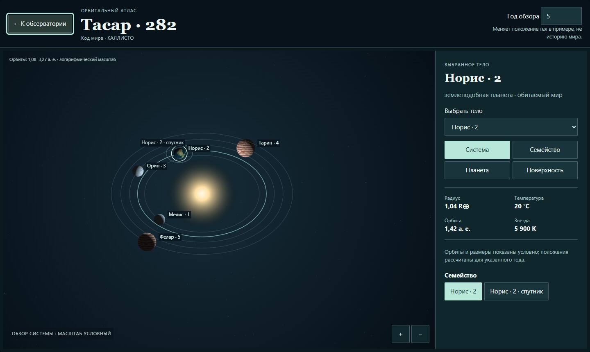
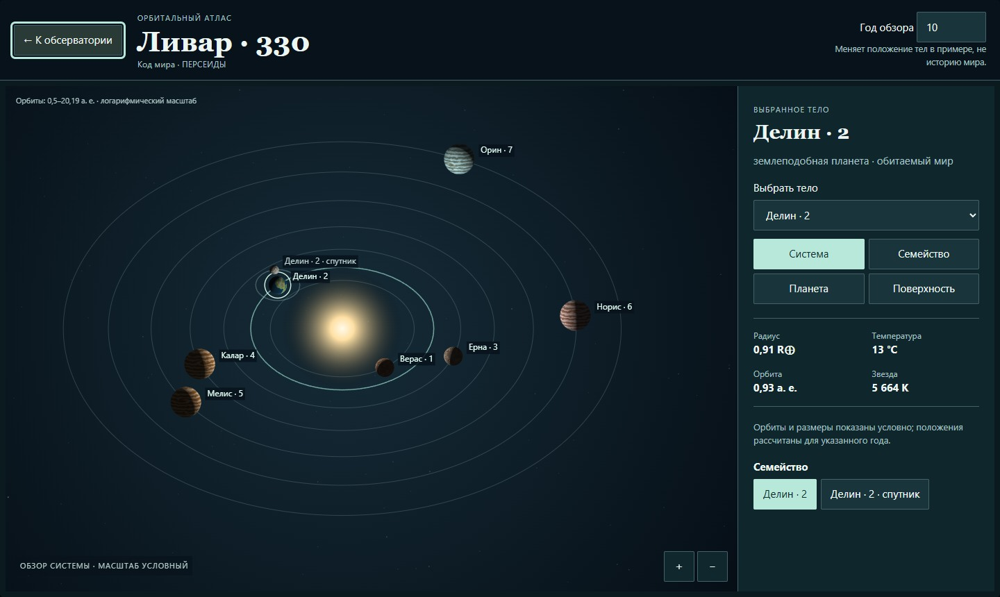
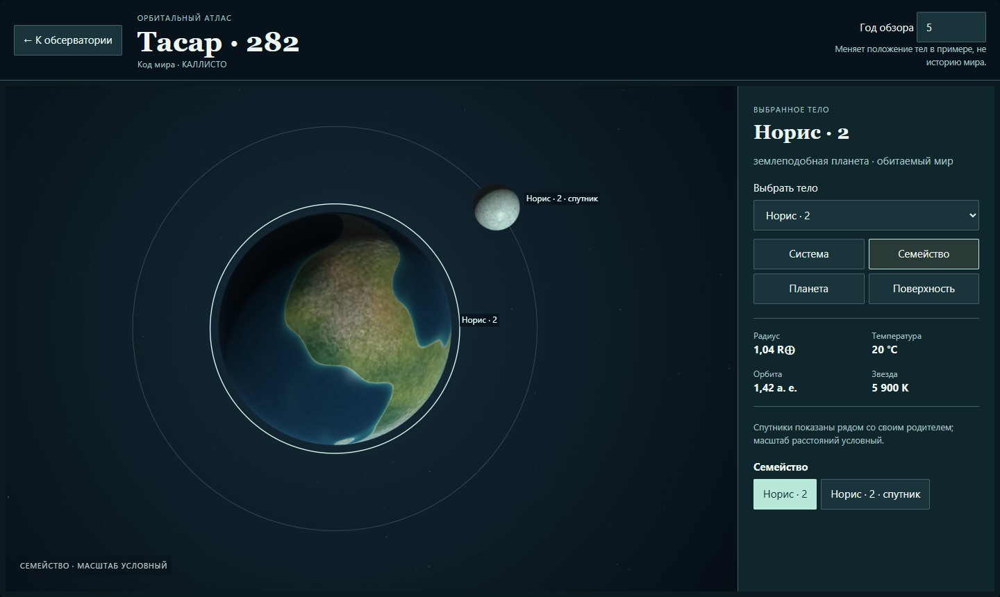
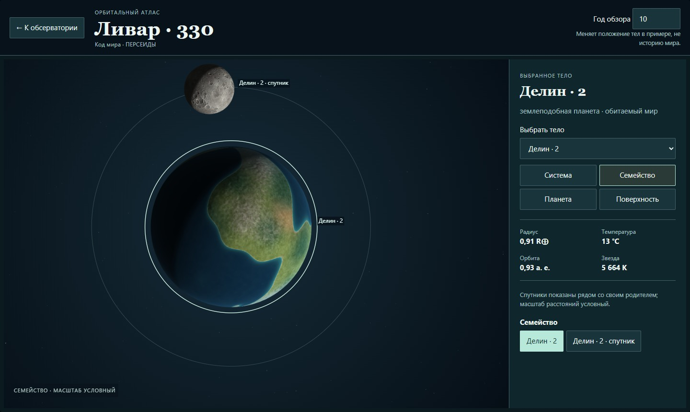
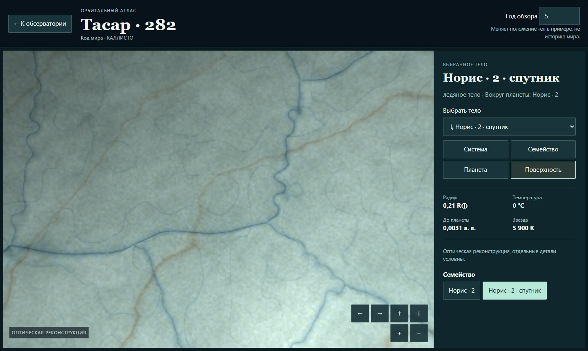
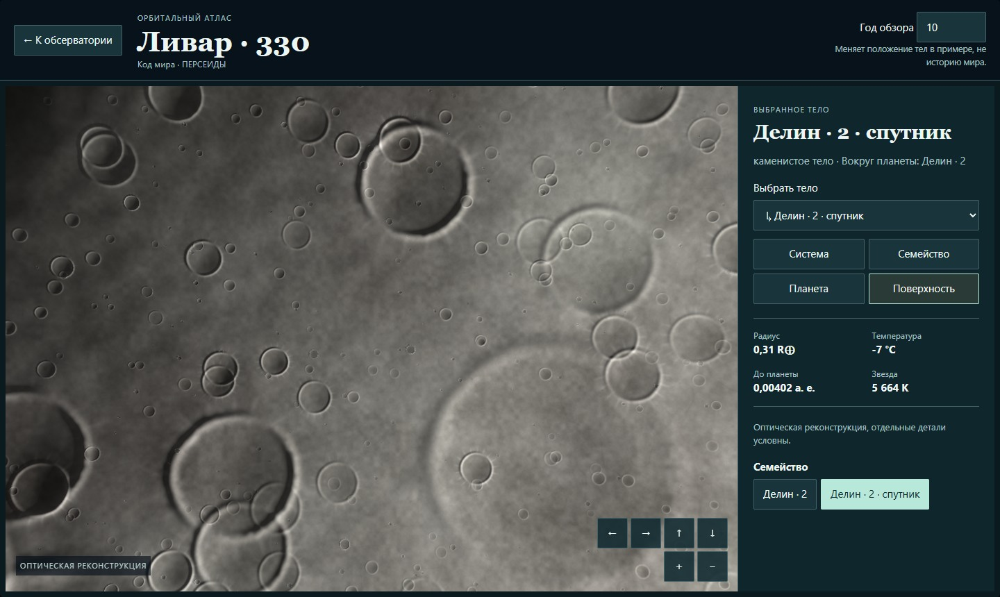

# Microgalaxy 1.2.0 — Орбитальный атлас

**18 ноября 2026 года.** У обсерватории появился маршрут от общей схемы системы до поверхности отдельной луны. Выберите тело, откройте его семейство и посмотрите, с какой стороны его освещает звезда. Та же луна остаётся выбранной при переходе от орбиты к крупному плану.

[Каллисто · открыть атлас](https://microgalaxy.gubarevf.chatgpt.site/v1?atlas=callisto) · [Персеиды · открыть атлас](https://microgalaxy.gubarevf.chatgpt.site/v1?atlas=perseids)

## От орбит до поверхности

В двух колонках — разные миры, созданные с начальной эпохой «Первые космические технологии». Каллисто и Персеиды — их коды. В заголовке атласа видны имена самих систем, Тасар · 282 и Ливар · 330. Каждая миниатюра открывает полный снимок, а ссылка над ней ведёт в соответствующий вид обсерватории.

| Масштаб | Каллисто · 5-й год обзора | Персеиды · 10-й год обзора |
| --- | --- | --- |
| Орбиты | [Пять планет Тасара](https://microgalaxy.gubarevf.chatgpt.site/v1?atlas=callisto)  | [Семь планет Ливара](https://microgalaxy.gubarevf.chatgpt.site/v1?atlas=perseids)  |
| Семейство | [Норис и его спутник](https://microgalaxy.gubarevf.chatgpt.site/v1?atlas=callisto&body=moon-p1&view=family)  | [Делин и его спутник](https://microgalaxy.gubarevf.chatgpt.site/v1?atlas=perseids&body=moon-p1&view=family)  |
| Поверхность | [Ледяная луна Нориса](https://microgalaxy.gubarevf.chatgpt.site/v1?atlas=callisto&body=moon-p1&view=surface)  | [Каменистая луна Делина](https://microgalaxy.gubarevf.chatgpt.site/v1?atlas=perseids&body=moon-p1&view=surface)  |

## Что попробовать

1. В «Системе» выберите вторую планету. Перейдите в «Семейство» и выберите спутник по имени или касанием его диска.
2. Откройте «Планету», чтобы увидеть освещённый диск целиком. Перейдите в «Поверхность» и поверните камеру. Ледяной и каменистый спутники имеют разные материалы. У газовых гигантов в этом режиме видны верхние облака.
3. Вернитесь в «Семейство» и измените «Год обзора». Сравните положение луны относительно родителя. Верните прежний год, чтобы увидеть ту же конфигурацию. В самостоятельном примере выбор года управляет орбитами и светом.

[Сравнить шесть видов на одном изображении](images/atlas-comparison.jpg)

В обзоре кнопки «+» и «−» меняют масштаб схемы.

## Что взято из мира

Тип, радиус, температура, родительское тело и параметры орбиты приходят из состояния мира. Положение зависит от начальной фазы, периода и выбранного года. На экране расстояния сжаты, а диски увеличены, чтобы можно было выбрать даже небольшой спутник. Береговая линия обитаемой планеты опирается на рельеф модели. Отдельные кратеры, ледяные трещины и облачные вихри — процедурные детали изображения.

## Свои сохранения

Откройте собственный мир и перейдите в «Систему». Атлас возьмёт тела и год из отображаемого состояния. На исходной обитаемой планете кнопка «Наблюдать места» ведёт к региону и его хронике. Самостоятельные атласы Каллисто и Персеид создаются отдельно в памяти.

Версия 1.2.0 относится к браузерному интерфейсу. Сохранённые миры моделей 1.0.0 и 1.0.1 открываются без миграции и продолжаются по правилам своей версии. [Возможности обсерватории](FUNCTIONS.md) · [История места в 1.1](RELEASE-1.1.md)
