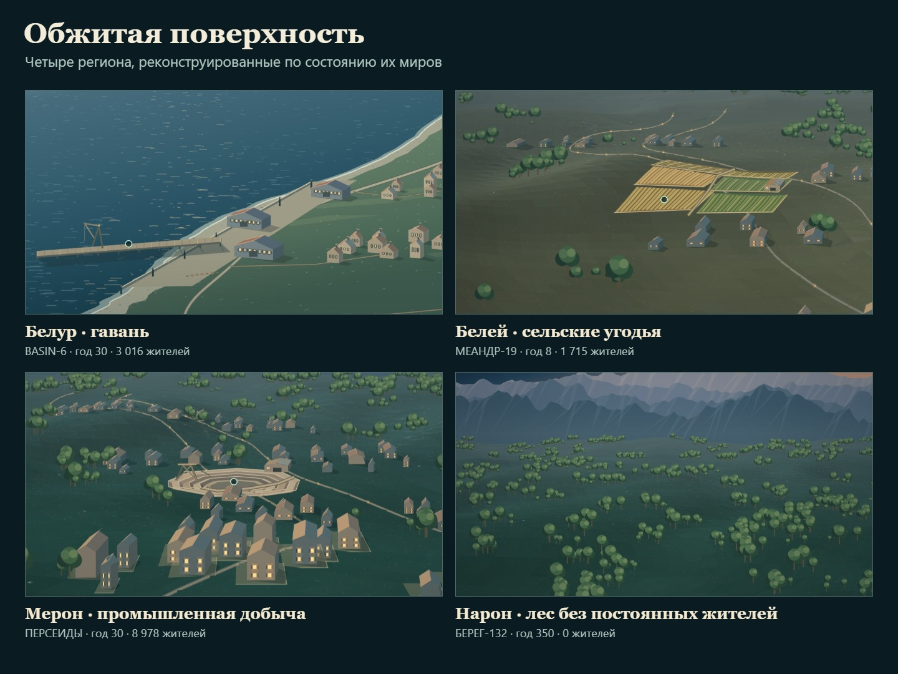
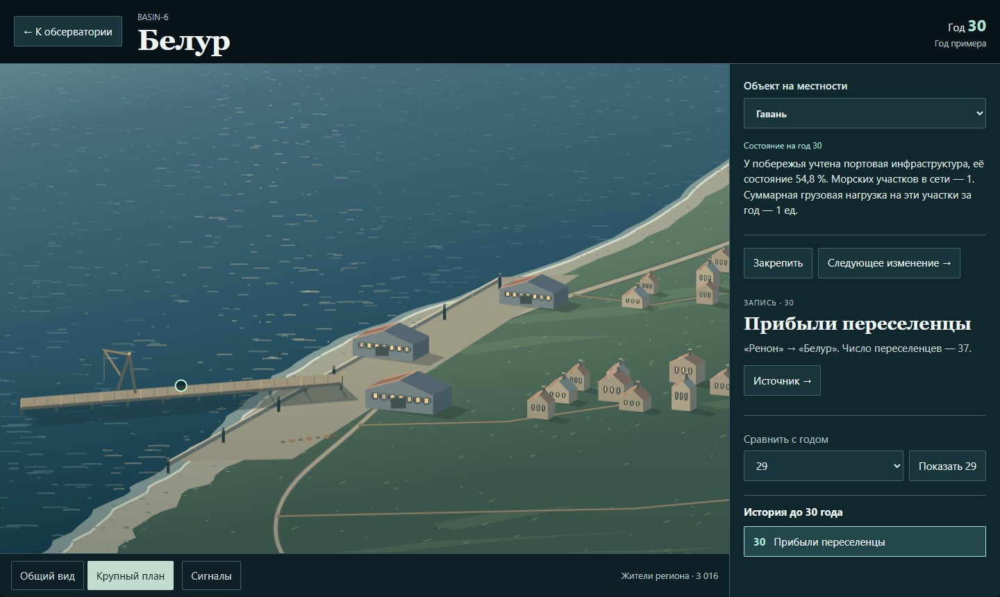
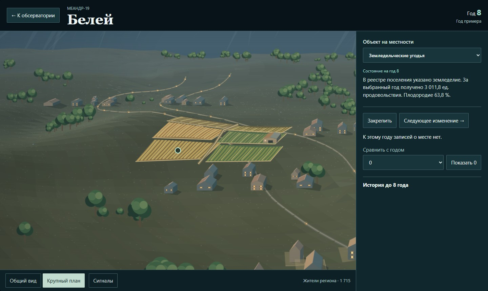
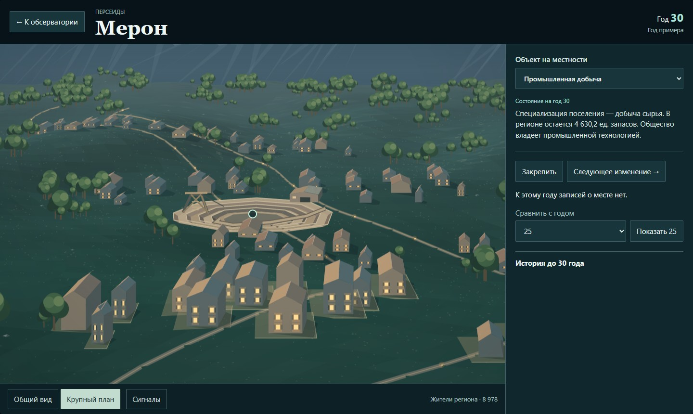
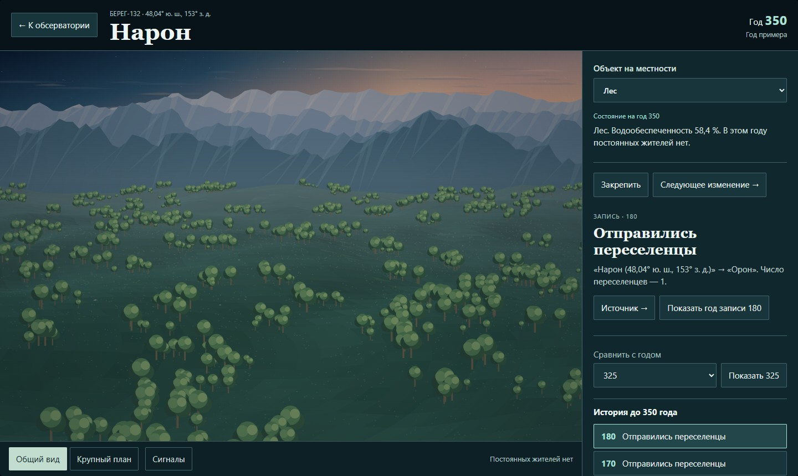
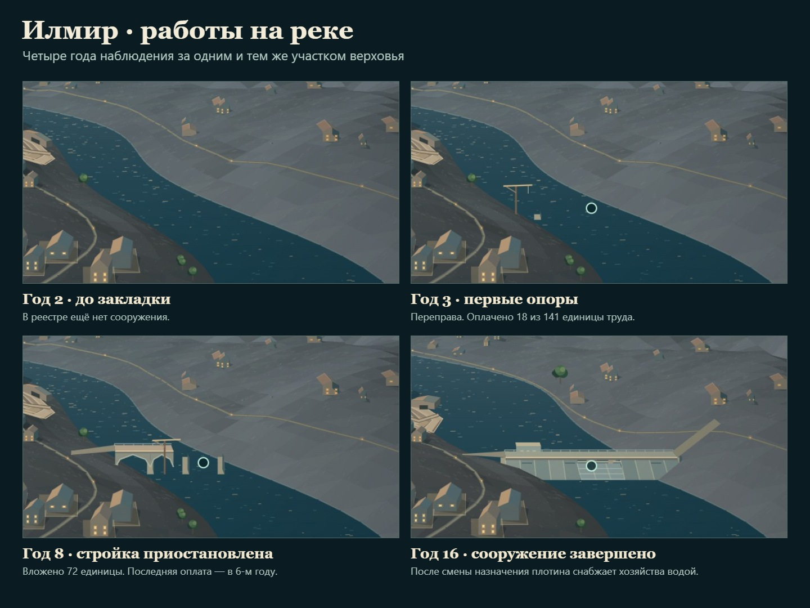

# Microgalaxy 1.3.0 — Обжитая поверхность

**18 ноября 2026 года.** Почему в одном месте видны причалы, в другом — поля, а в третьем сохранилось только название поселения? Приблизьте регион и выберите объект на сцене. Карточка покажет, какие сведения о нём есть в мире на этот год.

## Четыре места

| Место | Что показывает модель |
| --- | --- |
| [Гавань Белура](https://microgalaxy.gubarevf.chatgpt.site/v1?place=harbor)  | **BASIN-6 · 30-й год.** В прибрежном регионе живут 3 016 человек. Специализация поселения — порт. Состояние портовой инфраструктуры составляет 54,8 %. По единственному примыкающему морскому участку в этом году прошёл груз. Выберите «Гавань», чтобы прочитать ведомость. |
| [Сельские угодья Белея](https://microgalaxy.gubarevf.chatgpt.site/v1?place=farmland)  | **МЕАНДР-19 · 8-й год.** Белей лежит на лугах вдали от моря. Население региона — 1 715 человек. В карточке угодий указаны плодородие 63,8 % и урожай 3 011,8 единицы продовольствия за год. |
| [Промышленная добыча в Мероне](https://microgalaxy.gubarevf.chatgpt.site/v1?place=mining)  | **ПЕРСЕИДЫ · 30-й год.** В регионе 8 978 жителей. У поселения записана добывающая специализация, у общества Тамир действует промышленная технология. Запас месторождения сократился за год примерно с 4 636,4 до 4 630,2 единицы. Остаток указан в карточке выработки. |
| [Безлюдная местность Нарона](https://microgalaxy.gubarevf.chatgpt.site/v1?place=quiet)  | **БЕРЕГ-132 · 350-й год.** На 320-м году в регионе оставались два жителя, на 326-м — один. На 343-м году численность упала до нуля. На дату обзора здесь лес, урожай нулевой. Запись о путях сообщения сохранилась и доступна для выбора. |

Первые три наблюдения начинаются с промышленной эпохи, история Нарона — с ранних обществ. Все четыре примера рассчитаны обычной моделью 1.0.1. Откройте «Общий вид» или «Крупный план», переключите «Сигналы» и выберите объект с карты либо из списка. Население в карточках относится ко всему региону. Дома, ряды полей и отдельные постройки служат визуальной реконструкцией.

## Одна стройка в четырёх срезах

В Илмире на реке начали строить переправу. Работы приостановились, затем потребность хозяйств в воде изменила назначение сооружения. В каждой ссылке ниже открывается один и тот же регион мира МЕАНДР-19 в указанном году.

| Срез | Что искать в Илмире |
| --- | --- |
| [Год 2 · до закладки](https://microgalaxy.gubarevf.chatgpt.site/v1?place=meander&year=2) | Участок в верховье уже существует. Проекта и записи о работах ещё нет. |
| [Год 3 · начало работ](https://microgalaxy.gubarevf.chatgpt.site/v1?place=meander&year=3) | Оплачены первые 18 единиц труда из требуемых 141. Первоначальное назначение — переправа. |
| [Год 8 · остановка](https://microgalaxy.gubarevf.chatgpt.site/v1?place=meander&year=8) | Накоплено 72 единицы труда. Последняя оплата прошла в 6-м году. В решении 7-го года зафиксировано отсутствие доступного назначения. |
| [Год 16 · завершение](https://microgalaxy.gubarevf.chatgpt.site/v1?place=meander&year=16) | В 13-м году работы возобновились для снабжения хозяйств водой. К 16-му накоплены 144 единицы труда, в реестре отмечено завершение оросительной плотины. |

В карточке сооружения откройте «Запись о сооружении», затем «Источник». Другая местная история — в Реноне, где запись 30-го года связывает отъезд 37 жителей с засухой 28-го года. [Открыть хронику Ренона](https://microgalaxy.gubarevf.chatgpt.site/v1?place=basin)

## Версия и сохранения

1.3.0 обновляет браузерный интерфейс. В собственном мире выберите регион и нажмите «Приблизить место». Сцена строится по состоянию выбранной даты. Сохранения моделей 1.0.0 и 1.0.1 открываются без миграции и продолжаются по правилам своей версии. [Возможности обсерватории](FUNCTIONS.md) · [Орбитальный атлас 1.2](RELEASE-1.2.md)
